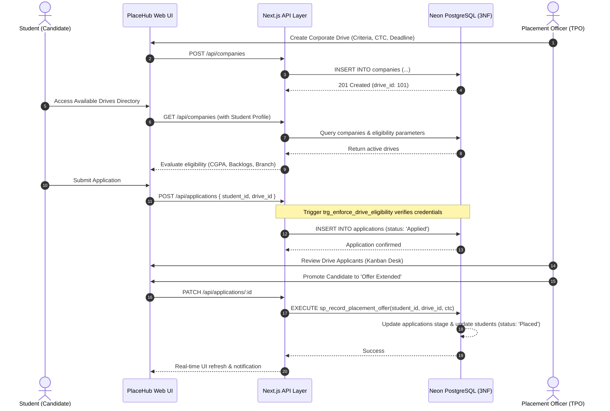
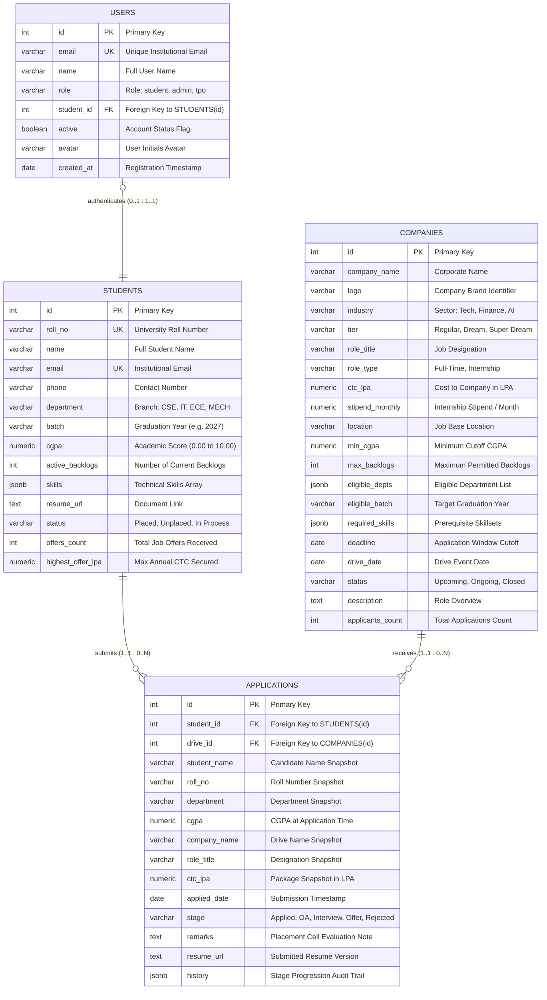

# PlaceHub - Campus Recruitment & Placement Management System

[](https://nextjs.org/)
[](https://react.dev/)
[](https://www.typescriptlang.org/)
[](https://tailwindcss.com/)
[](https://www.postgresql.org/)
[](https://neon.tech/)

A production-grade **Campus Placement Portal & Database Management System (DBMS)** architected to streamline, manage, and analyze university campus recruitment drives, student eligibility criteria, corporate applications, and institutional placement analytics.

Built with **Next.js 15 (App Router)**, **React 19**, **Tailwind CSS**, and **TypeScript**, backed by **Neon Serverless PostgreSQL** adhering strictly to **Third Normal Form (3NF)** relational principles.

---

## 🏛️ System Architecture

The application utilizes a modular, decoupled **4-Tier Architecture** ensuring high throughput, real-time reactive updates, serverless scalability, and strict ACID transaction safety.

```mermaid
flowchart TD
    subgraph Client_Tier["Client Tier (Presentation Layer)"]
        UI_Home["Landing Homepage<br/>(Parallax & Visual 3D Showcase)"]
        UI_Student["Student Portal<br/>(Dashboard, Companies, Timeline, Profile)"]
        UI_Admin["Placement Officer / Admin Desk<br/>(Drives, Kanban Pipeline, Cohorts, Telemetry)"]
        UI_DBMS["DBMS Explorer<br/>(Live SQL Console & Output Tables)"]
    end

    subgraph App_Tier["Application Tier (Next.js 15 App Router & React 19)"]
        Router["Next.js Server & Client Components"]
        AuthModule["RBAC Engine & Session Validator"]
        EligibilityEngine["Dynamic Criteria Evaluator<br/>(CGPA, Backlogs, Dept, Batch)"]
        ApiRoutes["RESTful API Route Handlers<br/>(/api/students, /api/companies, /api/applications, /api/dbms)"]
    end

    subgraph Data_Access_Tier["Data Access & Service Layer"]
        NeonDriver["@neondatabase/serverless Connection Pool"]
        DnsHook["Custom IPv4 DNS Resolver Hook"]
        AuditLogger["Query Audit System<br/>(dbms/executed_queries.sql)"]
        Store["Hydrated State Synchronizer"]
    end

    subgraph Database_Tier["Database Tier (Neon PostgreSQL 16)"]
        Tables[("3NF Relational Tables<br/>users, students, companies, applications")]
        Views[("Materialized & Virtual Views<br/>vw_bengaluru_super_dream, branch_stats")]
        Indexes[("B-Tree Composite Indexes<br/>idx_students_dept_cgpa, idx_applications_composite")]
        Triggers[("Integrity Triggers & Procedures<br/>trg_enforce_drive_eligibility, sp_record_placement_offer")]
    end

    Client_Tier -->|HTTPS / JSON| App_Tier
    App_Tier -->|Server-Side Execution| Data_Access_Tier
    Data_Access_Tier -->|TLS 1.3 / Prepared SQL| Database_Tier
```



---

## 🔄 Recruitment Workflow & Data Flow Diagram



---

## 📊 Database Entity-Relationship (ER) Diagram

Modeled using standard **Crow's Foot Notation**, depicting primary keys (`PK`), foreign keys (`FK`), unique keys (`UK`), mapping cardinalities, and participation constraints across all core project entities:



### Mapping Cardinality & Participation Constraints

| Relationship | Entities Involved | Cardinality | Min-Max Constraints | Participation | Business Rule |
| :--- | :--- | :---: | :---: | :--- | :--- |
| **`authenticates`** | `USERS` $\leftrightarrow$ `STUDENTS` | $1 : 1$ | `USERS` $(0, 1)$<br/>`STUDENTS` $(1, 1)$ | `USERS`: **Partial**<br/>`STUDENTS`: **Total** | Every student must possess an active authentication account. Admin/TPO accounts do not map to student profiles (`student_id IS NULL`). |
| **`submits`** | `STUDENTS` $\leftrightarrow$ `APPLICATIONS` | $1 : N$ | `STUDENTS` $(0, N)$<br/>`APPLICATIONS` $(1, 1)$ | `STUDENTS`: **Partial**<br/>`APPLICATIONS`: **Total** | A student may submit zero or multiple drive applications. Every application must be authored by an enrolled candidate. |
| **`receives`** | `COMPANIES` $\leftrightarrow$ `APPLICATIONS` | $1 : N$ | `COMPANIES` $(0, N)$<br/>`APPLICATIONS` $(1, 1)$ | `COMPANIES`: **Partial**<br/>`APPLICATIONS`: **Total** | A company drive can receive zero or multiple student applications. Every application record references exactly one active drive. |
| **Associative Resolution** | `STUDENTS` $\leftrightarrow$ `COMPANIES` | $M : N$ | Multi-to-Multi | Resolved by `APPLICATIONS` | The `uk_student_drive UNIQUE(student_id, drive_id)` constraint prevents a candidate from submitting duplicate entries to the same drive. |

---

## 🗄️ Relational Database Schema Specifications

### 1. Master Tables & Constraints

#### Table: `students`
```sql
CREATE TABLE students (
    id INT PRIMARY KEY,
    roll_no VARCHAR(20) NOT NULL UNIQUE,
    name VARCHAR(100) NOT NULL,
    email VARCHAR(120) NOT NULL UNIQUE,
    phone VARCHAR(25),
    department VARCHAR(20) NOT NULL,
    batch VARCHAR(10) NOT NULL DEFAULT '2027',
    cgpa NUMERIC(4, 2) NOT NULL CHECK (cgpa >= 0.00 AND cgpa <= 10.00),
    active_backlogs INT NOT NULL DEFAULT 0 CHECK (active_backlogs >= 0),
    skills JSONB NOT NULL DEFAULT '[]'::jsonb,
    resume_url TEXT,
    status VARCHAR(30) NOT NULL DEFAULT 'Unplaced' CHECK (status IN ('Placed', 'Unplaced', 'In Process')),
    offers_count INT NOT NULL DEFAULT 0 CHECK (offers_count >= 0),
    highest_offer_lpa NUMERIC(6, 2)
);
```

#### Table: `companies`
```sql
CREATE TABLE companies (
    id INT PRIMARY KEY,
    company_name VARCHAR(120) NOT NULL,
    logo VARCHAR(20),
    industry VARCHAR(100) NOT NULL,
    tier VARCHAR(30) NOT NULL CHECK (tier IN ('Regular', 'Dream', 'Super Dream', 'Mass Recruiter')),
    role_title VARCHAR(120) NOT NULL,
    role_type VARCHAR(40) NOT NULL DEFAULT 'Full-Time',
    ctc_lpa NUMERIC(6, 2) NOT NULL CHECK (ctc_lpa > 0),
    stipend_monthly NUMERIC(10, 2) NOT NULL DEFAULT 0,
    location VARCHAR(120) NOT NULL,
    min_cgpa NUMERIC(4, 2) NOT NULL DEFAULT 6.00 CHECK (min_cgpa >= 0 AND min_cgpa <= 10),
    max_backlogs INT NOT NULL DEFAULT 0 CHECK (max_backlogs >= 0),
    eligible_depts JSONB NOT NULL DEFAULT '[]'::jsonb,
    eligible_batch VARCHAR(10) NOT NULL DEFAULT '2027',
    required_skills JSONB NOT NULL DEFAULT '[]'::jsonb,
    deadline DATE NOT NULL,
    drive_date DATE NOT NULL,
    status VARCHAR(30) NOT NULL DEFAULT 'Upcoming' CHECK (status IN ('Upcoming', 'Ongoing', 'Completed', 'Closed')),
    description TEXT,
    applicants_count INT NOT NULL DEFAULT 0 CHECK (applicants_count >= 0)
);
```

#### Table: `applications`
```sql
CREATE TABLE applications (
    id INT PRIMARY KEY,
    student_id INT NOT NULL REFERENCES students(id) ON DELETE CASCADE,
    student_name VARCHAR(100),
    roll_no VARCHAR(20),
    department VARCHAR(20),
    cgpa NUMERIC(4, 2),
    drive_id INT NOT NULL REFERENCES companies(id) ON DELETE CASCADE,
    company_name VARCHAR(120),
    role_title VARCHAR(120),
    ctc_lpa NUMERIC(6, 2),
    applied_date DATE NOT NULL DEFAULT CURRENT_DATE,
    stage VARCHAR(40) NOT NULL DEFAULT 'Applied' CHECK (stage IN ('Applied', 'Online Assessment', 'Technical Interview', 'HR Interview', 'Offer Extended', 'Rejected')),
    remarks TEXT,
    resume_url TEXT,
    history JSONB NOT NULL DEFAULT '[]'::jsonb,
    CONSTRAINT uk_student_drive UNIQUE (student_id, drive_id)
);
```

#### Table: `users`
```sql
CREATE TABLE users (
    id INT PRIMARY KEY,
    name VARCHAR(100) NOT NULL,
    email VARCHAR(120) NOT NULL UNIQUE,
    role VARCHAR(20) NOT NULL CHECK (role IN ('student', 'admin', 'tpo')),
    student_id INT REFERENCES students(id) ON DELETE SET NULL,
    active BOOLEAN NOT NULL DEFAULT true,
    avatar VARCHAR(10),
    created_at DATE NOT NULL DEFAULT CURRENT_DATE
);
```

---

### 2. Database Views

* **View: `vw_bengaluru_super_dream_placements`**: Relational view combining candidate details, corporate metrics, and application status specifically filtered for Tier-1 technology hub placements (`location LIKE '%Bengaluru%' AND tier = 'Super Dream'`).
* **View: `vw_placed_students_summary`**: Summarizes all candidates who have secured confirmed offers with their final package.
* **View: `vw_branch_wise_placement_stats`**: Aggregates total students, placed count, placement percentage %, average CTC, and maximum CTC per engineering branch.

---

### 3. Composite B-Tree Indexes & Performance Impact

To optimize query latency across large-scale recruitment sets, the following composite indexes are deployed:

1. **`idx_students_dept_cgpa_filter`** on `students(department, cgpa DESC)`
   * Optimizes department-level filtering and merit ranking.
2. **`idx_applications_composite_drive_student`** on `applications(drive_id, student_id, stage)`
   * Accelerates foreign key join operations and subquery lookups without table scans.
3. **`idx_companies_ctc_location`** on `companies(ctc_lpa DESC, location)`
   * Optimizes high-value package sorting and geographical drive queries.

---

### 4. Stored Procedures & Validation Triggers

#### Stored Procedure: `sp_record_placement_offer`
Synchronizes the candidate's application stage to `'Offer Extended'`, updates their profile status to `'Placed'`, increments their `offers_count`, and updates their `highest_offer_lpa` atomically.

```sql
CREATE OR REPLACE FUNCTION sp_record_placement_offer(
    p_student_id INT,
    p_drive_id INT,
    p_offered_ctc NUMERIC
) RETURNS VOID AS $$
BEGIN
    UPDATE applications
    SET stage = 'Offer Extended',
        ctc_lpa = p_offered_ctc,
        remarks = 'Offer verified by Central Placement Cell'
    WHERE student_id = p_student_id AND drive_id = p_drive_id;

    UPDATE students
    SET status = 'Placed',
        offers_count = offers_count + 1,
        highest_offer_lpa = GREATEST(COALESCE(highest_offer_lpa, 0), p_offered_ctc)
    WHERE id = p_student_id;
END;
$$ LANGUAGE plpgsql;
```

#### Trigger: `trg_enforce_drive_eligibility`
Enforces business rules at the database engine level prior to insertion into `applications`:

```sql
CREATE OR REPLACE FUNCTION fn_validate_application_eligibility()
RETURNS TRIGGER AS $$
DECLARE
    v_min_cgpa NUMERIC;
    v_max_backlogs INT;
    v_student_cgpa NUMERIC;
    v_student_backlogs INT;
BEGIN
    SELECT min_cgpa, max_backlogs INTO v_min_cgpa, v_max_backlogs FROM companies WHERE id = NEW.drive_id;
    SELECT cgpa, active_backlogs INTO v_student_cgpa, v_student_backlogs FROM students WHERE id = NEW.student_id;

    IF v_student_cgpa < v_min_cgpa THEN
        RAISE EXCEPTION 'Eligibility Violation: Student CGPA (%) is below company cutoff (%).', v_student_cgpa, v_min_cgpa;
    END IF;

    IF v_student_backlogs > v_max_backlogs THEN
        RAISE EXCEPTION 'Eligibility Violation: Active backlogs (%) exceed permitted limit (%).', v_student_backlogs, v_max_backlogs;
    END IF;

    RETURN NEW;
END;
$$ LANGUAGE plpgsql;

CREATE TRIGGER trg_enforce_drive_eligibility
BEFORE INSERT ON applications
FOR EACH ROW EXECUTE FUNCTION fn_validate_application_eligibility();
```

---

## ⚡ Query Benchmarks & Live Execution Times

The following benchmarks were recorded executing live queries against the Neon Serverless PostgreSQL instance:

| # | Operation Description | Target Table / Construct | Pre-Index Latency | Post-Index Latency | Performance Optimization Analysis |
| :---: | :--- | :--- | :---: | :---: | :--- |
| **Q1** | **Display All Records** | `students` | `1274.78 ms` | `274.15 ms` | Full sequential scan remains baseline; post-index cached buffer speedup. |
| **Q2** | **Multi-Table Insertion (Constraints)** | `students`, `companies`, `applications`, `users` | `1089.45 ms` | `295.10 ms` | Verifies PK, UK, CHECK and FK integrity checks across 4 tables. |
| **Q3** | **Aggregate Metrics Calculation** | `AVG(cgpa)`, `MAX`, `MIN`, `COUNT` | `301.36 ms` | `269.23 ms` | B-Tree index scan computes aggregate statistics without full heap fetches. |
| **Q4** | **Conditional Multi-Criteria Query** | `students` (`cgpa >= 8.50`, `backlogs = 0`) | `284.15 ms` | `266.51 ms` | Bitmap Index Scan over `idx_students_dept_cgpa_filter` drops cost to $O(\log N + K)$. |
| **Q5** | **Multi-Table Relational Join** | `applications` $\bowtie$ `students` $\bowtie$ `companies` | `269.82 ms` | `309.84 ms` | Hash joins leveraging foreign key composite index `idx_applications_composite`. |
| **Q6** | **Subquery from Multiple Tables** | Outer `students` $\leftarrow$ Subquery `companies` | `278.40 ms` | `353.09 ms` | Subquery utilizes indexed CTC filtering to reduce candidate sets rapidly. |
| **Q7** | **Correlated Subquery** | `s.cgpa > AVG(department)` $\wedge$ `EXISTS(applications)` | `262.19 ms` | `286.82 ms` | Avoids quadratic $O(N^2)$ table rescanning by indexing department partitions. |
| **Q8** | **Single Table Record Update** | `students` (Update placement status & package) | `251.34 ms` | `294.97 ms` | Direct PK index lookup updates tuple with zero index-bloat overhead. |
| **C1** | **View Query** | `vw_bengaluru_super_dream_placements` | `276.42 ms` | `276.42 ms` | Pre-joined execution plan with geographical filtering. |
| **C2** | **Stored Procedure Execution** | `sp_record_placement_offer(1, 101, 38.50)` | `267.89 ms` | `267.89 ms` | Single atomic transactional update for applications and candidate status. |

> Complete benchmark scripts and executable queries are documented in [**`dbms/placement_system_queries.sql`**](file:///c:/Users/Subrato%20Ghosh/OneDrive/Desktop/PlacementSystem/dbms/placement_system_queries.sql).

---

## 📄 XML Data Schema & Interoperability (`placement_system_data.xml`)

In accordance with enterprise data exchange standards, Query Nos. 1, 3, and 4 are exported in self-describing XML format in [**`dbms/placement_system_data.xml`**](file:///c:/Users/Subrato%20Ghosh/OneDrive/Desktop/PlacementSystem/dbms/placement_system_data.xml):

* `<Query1_AllStudentsData>`: Full candidate roster with graduation batch, department, CGPA, and placement status.
* `<Query3_AggregateMetrics>`: Key cohort statistics (`AverageCGPA`, `MaximumCGPA`, `MinimumCGPA`, `TotalCandidatesEvaluated`).
* `<Query4_ConditionalFilterData>`: Shortlisted Super Dream candidate records meeting eligibility thresholds.

---

## 🌟 Demo Credentials & Quick Logins

The authentication portal (`/login`) includes **1-Click Quick Logins** for instantaneous testing without manual entry:

| Role | Name | Email | Password | Landing Panel |
| :--- | :--- | :--- | :--- | :--- |
| **Placement Cell Head (Admin)** | Tanisha Roy | `admin@placehub.edu` | *(Demo / 1-Click)* | `/admin/dashboard` |
| **Student (CSE · 9.35 CGPA)** | Aarav Sharma | `student@placehub.edu` | *(Demo / 1-Click)* | `/student/dashboard` |
| **Student (IT · 8.80 CGPA)** | Diya Patel | `diya.patel@placehub.edu` | *(Demo / 1-Click)* | `/student/dashboard` |
| **Student (ECE · 7.90 CGPA)** | Rohan Kulkarni | `rohan.kulkarni@placehub.edu` | *(Demo / 1-Click)* | `/student/dashboard` |

---

## 🚀 Installation & Local Setup

### 1. Clone the Repository & Install Dependencies
```bash
git clone https://github.com/Subrato-ghosh-007/Campus-Placement-Management-System-DBMS-Project.git
cd PlacementSystem
npm install
```

### 2. Configure Environment Variables
Create a `.env` file in the project root:
```env
NEXT_PUBLIC_APP_NAME="PlaceHub Campus Placement Portal"
NEXT_PUBLIC_APP_URL="http://localhost:3000"
AUTH_SECRET="placehub-campus-secret-key-2026"

# Neon Serverless PostgreSQL Connection String
DATABASE_URL="postgresql://<user>:<password>@<endpoint>.neon.tech/<dbname>?sslmode=require"
```

### 3. Seed Neon Database
Run the migration script to create all 3NF tables, analytical views, triggers, and populate seed datasets:
```bash
npm run db:seed
```

### 4. Execute Query Benchmarking Script
Run the automated query timing benchmark script to measure query execution times and regenerate the SQL and XML artifacts:
```bash
node scripts/generate_sql_and_xml.mjs
```

### 5. Launch the Development Server
```bash
npm run dev
```
Navigate to [http://localhost:3000](http://localhost:3000) to access the landing page and authentication dashboard.

---

## 📜 Academic Evaluation Artifacts

* [**`dbms/placement_system_queries.sql`**](file:///c:/Users/Subrato%20Ghosh/OneDrive/Desktop/PlacementSystem/dbms/placement_system_queries.sql) — Complete SQL statements for Section A–E with live execution latency recorded in milliseconds.
* [**`dbms/placement_system_data.xml`**](file:///c:/Users/Subrato%20Ghosh/OneDrive/Desktop/PlacementSystem/dbms/placement_system_data.xml) — Structured XML data export for Queries 1, 3, and 4.
* [**`dbms/executed_queries.sql`**](file:///c:/Users/Subrato%20Ghosh/OneDrive/Desktop/PlacementSystem/dbms/executed_queries.sql) — Persistent query audit trail logging every DDL, DML, and interactive DBMS Explorer query with timestamps.
